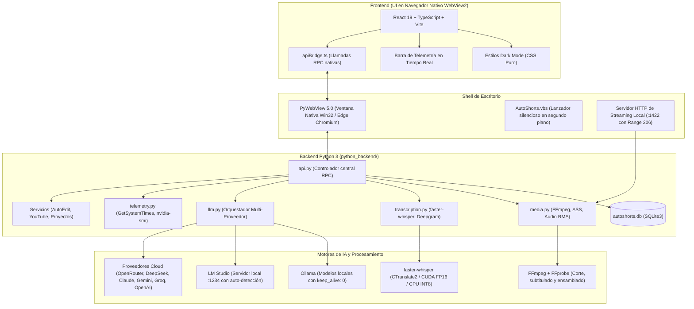

# AutoShorts

[](https://www.python.org/)
[](https://react.dev/)
[](https://www.typescriptlang.org/)
[](https://vitejs.dev/)
[](https://pywebview.flowrl.com/)
[](https://ffmpeg.org/)
[](https://github.com/SYSTRAN/faster-whisper)
[](https://opensource.org/licenses/MIT)

**AutoShorts** es una suite de escritorio de código abierto para creadores de contenido, streamers y editores. Automatiza la transformación de transmisiones en directo de larga duración (streams de 1 a 4+ horas en Twitch, Kick o YouTube) y podcasts en dos formatos principales:

1. **Clips Verticales de Alto Impacto (9:16 Shorts, TikToks, Reels):** Detección de momentos clave mediante análisis acústico y semántico, subtítulos dinámicos con animación pop estilo karaoke, insignias animadas de llamada a la acción y generación de copies optimizados para redes sociales.
2. **Autoedición y Resúmenes para YouTube (16:9 o 9:16):** Ensamblado narrativo de 1 a 30 minutos con supresión de pausas y silencios muertos, teaser gancho de apertura, marcas de tiempo para capítulos de YouTube (`Descripcion_YouTube.txt`) y miniaturas en alta definición (1080p).

> [!NOTE]
> **Arquitectura en Python 3:** A diferencia del proyecto original basado en Rust/Tauri, este desarrollo migró el backend completo a **Python 3**. Esto elimina las dependencias pesadas de compilación en C++/Rust, permite el uso directo de modelos de IA locales con aceleración CUDA (faster-whisper, PyTorch, Ollama, LM Studio) y simplifica la extensibilidad del pipeline multimedia.

---

## Índice

- [Arquitectura del Sistema](#arquitectura-del-sistema)
- [Funcionalidades Principales](#funcionalidades-principales)
  - [1. Detección Inteligente de Momentos](#1-detección-inteligente-de-momentos)
  - [2. Estudio de Subtítulos Dinámicos y Presets](#2-estudio-de-subtítulos-dinámicos-y-presets)
  - [3. Autoedición de Larga Duración para YouTube](#3-autoedición-de-larga-duración-para-youtube)
  - [4. Soporte Multi-LLM y Control de VRAM](#4-soporte-multi-llm-y-control-de-vram)
  - [5. Módulo Quick Copy para Transcripciones y Subtítulos](#5-módulo-quick-copy-para-transcripciones-y-subtítulos)
  - [6. Importador Directo de YouTube](#6-importador-directo-de-youtube)
  - [7. Telemetría de Hardware sin Bloqueo](#7-telemetría-de-hardware-sin-bloqueo)
- [Requisitos Previos y Compatibilidad](#requisitos-previos-y-compatibilidad)
- [Instalación Paso a Paso](#instalación-paso-a-paso)
- [Modos de Ejecución](#modos-de-ejecución)
- [Compilación del Ejecutable de Windows (.exe)](#compilación-del-ejecutable-de-windows-exe)
- [Configuración y Variables de Entorno](#configuración-y-variables-de-entorno)
- [Estructura del Repositorio](#estructura-del-repositorio)
- [Resolución de Problemas Frecuentes](#resolución-de-problemas-frecuentes)
- [Créditos y Licencia](#créditos-y-licencia)

---

## Arquitectura del Sistema

El siguiente diagrama detalla la interacción entre la interfaz React 19, el puente de escritorio PyWebView, los servicios de Python y los motores locales y en la nube:



---

## Funcionalidades Principales

### 1. Detección Inteligente de Momentos

El algoritmo de detección procesa transmisiones largas combinando dos fuentes de análisis complementarias:

- **Segmentación adaptativa con solapamiento:** Divide videos de varias horas en bloques de 10 minutos con 30 segundos de solapamiento mutuo. Esto asegura que anécdotas o jugadas situadas en el límite de un bloque no queden truncadas.
- **Análisis acústico RMS en milisegundos:** Módulo en Python puro (`wave`, `struct`, `math`) sin librerías externas pesadas. Procesa una hora de audio en menos de 1.6 segundos. Identifica picos de energía sonora (disparos, explosiones o gritos) que ocurren cuando el jugador se concentra y no habla, inyectando etiquetas `[CLUTCH / ACCIÓN ACÚSTICA]` en la transcripción para que el LLM no descarte el fragmento.
- **Perfiles de contenido:**
  - *Gaming:* Prioriza jugadas clutch, bajas consecutivas y reacciones.
  - *Tutorial:* Enfocado en explicaciones técnicas, advertencias y pasos clave.
  - *Podcast / Charla:* Identifica anécdotas, debates y cambios de postura argumental.
  - *General:* Balance automático de diálogo y momentos destacados.
- **Duraciones objetivo configurables:** Selección precisa de clips en rangos de 30s, 1m, 2m, 3m o 5m.

---

### 2. Estudio de Subtítulos Dinámicos y Presets

El motor multimedia genera subtítulos nativos en formato SubStation Alpha (`.ass`) con sincronización palabra por palabra, renderizados mediante el filtro `ass` de FFmpeg con soporte de aceleración por hardware:

| Preset | Tipografía | Paleta y Resalte | Descripción |
| :--- | :--- | :--- | :--- |
| **`tiktok-karaoke`** | Arial Black | Blanco con resalte amarillo neón | Estilo clásico de alta retención con animación de escala (*jump/pop*) en la palabra activa. |
| **`loud-viral`** | Impact (Ultra-bold) | Trazo 3D masivo, amarillo lima y fuego naranja | Diseñado para videos dinámicos estilo MrBeast con resaltado agresivo en términos clave. |
| **`arcade-retro`** | Trebuchet MS | Borde rosa magenta con resalte cian activo | HUD tecnológico inspirado en estética gamer y transmisiones de deportes electrónicos. |
| **`cyber-terminal`** | Consolas (Monospace) | Verde fósforo con resalte cian eléctrico | Aspecto de consola de desarrollo o temática hacker. |
| **`clean-editorial`** | Segoe UI | Blanco puro, borde fino y sombra suave multinivel | Adecuado para podcasts, entrevistas y contenido corporativo o formativo. |
| **`modern-box`** | Arial | Texto sobre caja opaca delimitada | Máxima legibilidad en fondos con alto nivel de ruido visual o cambios de contraste. |

#### Opciones de Personalización
- **Posición vertical:** Superior, Centro o Inferior (para evitar superposiciones con la interfaz del juego, la cámara del creador o los botones de TikTok/Reels).
- **Densidad de líneas:** Selección entre 1 o 2 líneas visibles simultáneamente.
- **Insignias CTA animadas:** Generación dinámica de distintivos de llamada a la acción ("Suscríbete", "Sígueme para parte 2") con tres tipos de animación: aterrizaje con rebote (*bounce-land*), deslizamiento (*slide-in*) o aparición sutil.

---

### 3. Autoedición de Larga Duración para YouTube

AutoShorts incluye un entorno de trabajo específico para producir resúmenes completos de streams y podcasts listos para publicar:

- **Duraciones objetivo flexibles:** Selección entre 1, 2, 3, 4, 5, 8, 10, 12, 15, 20, 25 o 30 minutos.
- **Relaciones de aspecto:** Formato horizontal estándar (16:9) o vertical para recopilaciones largas (9:16).
- **Supresión de silencios muertos (`detect_dead_air_silences`):** El motor detecta pausas prolongadas e interrupciones vacías en la pista de audio y recorta automáticamente los fragmentos muertos sin alterar la fluidez del habla.
- **Teaser gancho inicial (`includeTeaser`):** Extrae los primeros segundos del momento con mayor puntuación viral y los sitúa al inicio del video a modo de gancho introductorio.
- **Marcas de tiempo automáticas:** Genera la estructura de capítulos cronológicos y guarda el archivo `Descripcion_YouTube.txt` en la carpeta del proyecto, listo para copiar y pegar en la descripción de YouTube.
- **Miniaturas HD (1080p):** Captura el fotograma de mayor tensión o expresividad del video y propone alternativas de títulos.

---

### 4. Soporte Multi-LLM y Control de VRAM

AutoShorts funciona con modelos de lenguaje locales y en la nube a través de una interfaz unificada:

#### Inferencia 100% Local y Privada
- **Ollama:** Compatible con `qwen2.5`, `qwen3.5`, `llama3.2`, `mistral`, `gemma2`, entre otros. Descargador de modelos integrado con seguimiento porcentual dentro de la aplicación.
- **LM Studio:** Auto-detección del modelo activo consultando el endpoint local `/v1/models`.
- **Descarga inmediata de VRAM (`keep_alive: 0`):** Al finalizar el análisis del guión o la extracción de momentos, la aplicación solicita al servidor local la liberación inmediata de la memoria gráfica para evitar caídas de rendimiento en juegos o al renderizar video con FFmpeg. También ofrece un selector manual para mantener el modelo residente si se realizan consultas frecuentes.
- **Supresión de etiquetas de razonamiento:** Filtra bloques internos de pensamiento (`<think>`) en modelos como DeepSeek R1 o Qwen pensando en frío, asegurando respuestas limpias en formato JSON sin desperdicio de tokens.

#### Proveedores en la Nube
- Soporte para **OpenRouter**, **DeepSeek**, **Anthropic Claude**, **Google Gemini**, **OpenAI GPT-4o** y **Groq**.
- Algoritmo de reintentos exponenciales automáticos ante saturación de servidores o límites de velocidad (códigos HTTP 429).

---

### 5. Módulo Quick Copy para Transcripciones y Subtítulos

Permite redactar copys persuasivos (gancho, desarrollo, llamada a la acción y etiquetas) a partir de tres fuentes de entrada:

- **Carga de subtítulos (`.srt`, `.vtt`, `.txt`):** Analizador sintáctico que limpia números de secuencia, códigos de tiempo y etiquetas de formato para entregar al modelo únicamente el texto continuo.
- **Entrada de texto directo:** Área de pegado manual con contador de palabras y caracteres en tiempo real.
- **Archivo multimedia directo:** Extracción de audio y transcripción automática en un solo paso.
- **Regeneración contextual:** Botón para reescribir el copy de cualquier clip ya exportado manteniendo inalterado el título original.

---

### 6. Importador Directo de YouTube

- Descarga automática de videos a `Downloads/AutoShorts` mediante `yt-dlp`.
- **Inspección preventiva de licencias (`check_youtube_copyright`):** Comprueba los metadatos del video antes de comenzar la descarga y alerta al usuario si el contenido cuenta con Licencia Estándar de YouTube o si dispone de licencia Creative Commons.

---

### 7. Telemetría de Hardware sin Bloqueo

Barra de estado persistente en la parte inferior de la ventana con actualización periódica:
- **Uso de CPU (%):** Calculado mediante llamadas a la API de Windows `GetSystemTimes` en hilo no bloqueante.
- **Uso de GPU y VRAM:** Medido a través de `nvidia-smi` en formato estructurado, con mecanismo de respaldo en PyTorch CUDA.
- **Temperatura de la GPU (°C):** Supervisión térmica en tiempo real durante procesos intensivos de renderizado o transcripción.

---

## Requisitos Previos y Compatibilidad

| Componente | Requisito Mínimo | Recomendado | Notas |
| :--- | :--- | :--- | :--- |
| **Sistema Operativo** | Windows 10 (64-bit) | Windows 11 (64-bit) | Compatible también con Linux y macOS en modo desarrollo. |
| **Python** | 3.10 | **3.11.x** | Versión recomendada para compatibilidad con PyTorch CUDA y PyWebView. |
| **Node.js** | 18.x (LTS) | 20.x o superior | Requerido para compilar los recursos de la interfaz. |
| **Gestor de Paquetes** | npm 9+ | **pnpm 9+** | Recomendado para instalaciones más rápidas y menor uso de disco. |
| **FFmpeg y FFprobe** | Versión 5.x | **Versión 6.x o 7.x en el PATH** | Indispensable para corte de video, generación de subtítulos y audio RMS. |
| **GPU (Opcional)** | CPU Intel / AMD | **NVIDIA RTX con drivers CUDA** | Acelera notablemente la transcripción local con faster-whisper. |

### Instalación de FFmpeg

Asegúrate de que `ffmpeg` y `ffprobe` respondan desde tu consola:

- **Windows (PowerShell):**
  ```powershell
  winget install Gyan.FFmpeg
  ```
  *O descarga los binarios desde [gyan.dev](https://www.gyan.dev/ffmpeg/builds/) y añade la carpeta `bin` a tu variable de entorno `PATH`.*
- **macOS:**
  ```bash
  brew install ffmpeg
  ```
- **Linux (Ubuntu / Debian):**
  ```bash
  sudo apt update && sudo apt install -y ffmpeg
  ```

---

## Instalación Paso a Paso

### 1. Clonar el Repositorio
```bash
git clone https://github.com/jeffd2599/autoshorts.git
cd autoshorts
```

### 2. Configurar el Entorno Virtual de Python
```bash
# Crear entorno virtual
python -m venv venv

# Activar en Windows (PowerShell):
.\venv\Scripts\Activate.ps1

# Activar en Linux o macOS:
source venv/bin/activate
```

### 3. Instalar PyTorch

Para acelerar la transcripción local con Whisper mediante hardware NVIDIA:

```bash
# Con soporte NVIDIA CUDA 12.1 (Recomendado):
pip install torch torchvision torchaudio --index-url https://download.pytorch.org/whl/cu121

# O versión para CPU / sin tarjeta gráfica dedicada:
pip install torch torchvision torchaudio
```

### 4. Instalar Dependencias del Backend
```bash
pip install -r requirements.txt
```

### 5. Instalar Dependencias y Compilar el Frontend
```bash
# Con pnpm (recomendado):
pnpm install
pnpm run build

# O con npm:
npm install
npm run build
```

---

## Modos de Ejecución

### Modo Producción (Uso Habitual)

Inicia el entorno de escritorio completo:
```bash
python run.py
```

En Windows, también puedes iniciar la aplicación sin que aparezca la ventana de consola haciendo doble clic en el script silencioso:
```text
AutoShorts.vbs
```

El script realiza las siguientes operaciones de forma automática:
1. Inicia el servidor local de streaming en `http://127.0.0.1:1422`.
2. Verifica los archivos construidos en la carpeta `dist/`.
3. Crea y muestra la ventana de escritorio basada en Microsoft Edge WebView2.

---

### Modo Desarrollo (Hot Reload)

Para modificar la interfaz con recarga en tiempo real mientras el backend de Python permanece activo:

1. **Terminal 1 (Servidor de Desarrollo Vite):**
   ```bash
   pnpm run dev
   ```
2. **Terminal 2 (Lanzador de Escritorio):**
   ```bash
   python run.py
   ```

El lanzador detectará automáticamente el servidor en `http://127.0.0.1:1420` y conectará la ventana nativa a este puerto.

---

## Compilación del Ejecutable de Windows (.exe)

AutoShorts incluye un script automatizado para empaquetar la aplicación en un ejecutable independiente para Windows sin requerir instalación de Python en la máquina destino:

```bash
python build_exe.py
```

### Fases del Proceso de Empaquetado
1. Convierte automáticamente el archivo `icon.png` a `icon.ico` si no existe.
2. Compila el frontend de React mediante `pnpm run build`.
3. Invoca a **PyInstaller** utilizando la configuración definida en `AutoShorts.spec`.
4. Genera la distribución completa en:
   ```text
   release/AutoShorts/AutoShorts.exe
   ```

Puedes distribuir la carpeta `release/AutoShorts/` directamente o crear un acceso directo a `AutoShorts.exe` en tu escritorio.

---

## Configuración y Variables de Entorno

Puedes configurar tus claves de API mediante un archivo `.env` en la raíz del proyecto o directamente desde el panel de ajustes de la aplicación:

```env
# Transcripción Cloud
DEEPGRAM_API_KEY=tu_clave_deepgram_aqui

# Proveedores de Modelos de Lenguaje
LLM_PROVIDER=ollama
ANTHROPIC_API_KEY=tu_clave_anthropic
DEEPSEEK_API_KEY=tu_clave_deepseek
GROQ_API_KEY=tu_clave_groq
GEMINI_API_KEY=tu_clave_gemini
OPENAI_API_KEY=tu_clave_openai
OPENROUTER_API_KEY=tu_clave_openrouter

# Servidor Local LM Studio (Opcional, por defecto http://127.0.0.1:1234/v1)
LMSTUDIO_BASE_URL=http://127.0.0.1:1234/v1
```

La configuración interna de la aplicación (modelo Whisper predeterminado, estilo de subtítulos seleccionado, rutas de guardado) se almacena en:
```text
%USERPROFILE%\.autoshorts\config.json
```

---

## Estructura del Repositorio

```text
autoshorts/
├── python_backend/               # Backend en Python 3
│   ├── api.py                    # Controlador RPC principal expuesto a PyWebView
│   ├── db.py                     # Capa de datos en SQLite3 embebido
│   ├── llm.py                    # Orquestador Multi-LLM (Ollama, LM Studio y Cloud)
│   ├── llm_prompts.py            # Plantillas de prompts especializadas por formato
│   ├── media.py                  # Integración con FFmpeg, subtítulos ASS y audio RMS
│   ├── stream_server.py          # Servidor HTTP local con soporte Range para videos
│   ├── telemetry.py              # Telemetría de CPU, GPU, VRAM y temperatura
│   ├── transcription.py          # Pipelines de faster-whisper, Whisper y Deepgram
│   └── services/                 # Lógica desacoplada de negocio
│       ├── autoedit_service.py   # Servicio de ensamblado para videos de YouTube
│       ├── project_service.py    # Gestión de carpetas y re-vinculación de archivos
│       └── youtube_service.py    # Descarga e inspección de derechos con yt-dlp
├── src/                          # Frontend en React 19 + TypeScript
│   ├── components/               # Componentes modulares de interfaz
│   │   ├── common/               # Componentes reutilizables (StatusBar, ModelBadge)
│   │   ├── modals/               # Modales de trabajo (Estudio, AutoEdit, QuickCopy)
│   │   └── panels/               # Vistas principales (Dashboard, Clips, AutoEdit)
│   ├── hooks/                    # Hooks personalizados de estado y pipelines
│   ├── styles/                   # Sistema de diseño dark mode en CSS puro
│   ├── types.ts                  # Definiciones de tipos TypeScript compartidos
│   ├── apiBridge.ts              # Adaptador para comunicación RPC bidireccional
│   └── App.tsx                   # Componente raíz de la aplicación
├── build_exe.py                  # Script de empaquetado para Windows (.exe)
├── AutoShorts.spec               # Especificación de PyInstaller
├── AutoShorts.vbs                # Lanzador silencioso sin consola para Windows
├── run.py                        # Punto de entrada principal de la aplicación
├── requirements.txt              # Dependencias de Python
├── package.json                  # Scripts y dependencias del frontend
├── vite.config.ts                # Configuración del empaquetador Vite
└── README.md                     # Documentación técnica del proyecto
```

---

## Resolución de Problemas Frecuentes

### 1. `ffmpeg` o `ffprobe` no se reconocen como un comando interno
- Verifica que instalaste FFmpeg y que la ruta a su subcarpeta `bin` se encuentra en las variables de entorno del sistema (`PATH`).
- Abre una ventana nueva de PowerShell y comprueba la salida con `ffmpeg -version`.

### 2. Whisper no utiliza la GPU NVIDIA
- Comprueba que instalaste la versión de PyTorch compilada con soporte CUDA.
- Puedes verificarlo ejecutando en consola:
  ```bash
  python -c "import torch; print('CUDA disponible:', torch.cuda.is_available(), '| Dispositivo:', torch.cuda.get_device_name(0) if torch.cuda.is_available() else 'Ninguno')"
  ```
- Si devuelve `False`, desinstala torch y vuelve a instalar la versión con índice `cu121` indicada en el paso 3 de la guía de instalación.

### 3. No se detecta Ollama o LM Studio
- **Ollama:** Comprueba que el servicio está activo visitando en tu navegador `http://127.0.0.1:11434`.
- **LM Studio:** En la pestaña "Local Server", asegúrate de presionar el botón "Start Server" y verifica que el puerto sea el `1234`.

### 4. El archivo fuente del video se movió o renombró
- Si cambiaste de ubicación una grabación original, AutoShorts marcará el archivo con una advertencia en la lista de proyectos.
- Haz clic en el botón de re-vincular (icono de carpeta de búsqueda) para seleccionar la nueva ruta del archivo sin perder tus transcripciones ni tus momentos detectados.

---

## Créditos y Licencia

Este proyecto es una evolución y desarrollo derivado del trabajo conceptual de [JayWebtech/autoshorts](https://github.com/JayWebtech/autoshorts).

### Fundamentos de la Migración a Python
La versión conceptual previa utilizaba una arquitectura basada en Rust (Tauri). Para este desarrollo, el backend fue reescrito íntegramente en **Python 3.11**, aportando ventajas directas:
1. **Instalación directa sin herramientas de compilación complejas:** Elimina la necesidad de instalar el toolchain de Rust (`cargo`, `rustc`) ni Microsoft Visual C++ Build Tools.
2. **Acceso al ecosistema nativo de Machine Learning:** Integración inmediata con PyTorch, aceleración CUDA, faster-whisper con CTranslate2 y comunicación directa con servidores locales de LLM.
3. **Facilidad de personalización:** El procesamiento multimedia, las llamadas a FFmpeg y los algoritmos de detección acústica RMS pueden auditarse y modificarse directamente en código Python legible.

Este software se distribuye bajo los términos de la **Licencia MIT**. Consulta el archivo [LICENSE](LICENSE) para más información.
