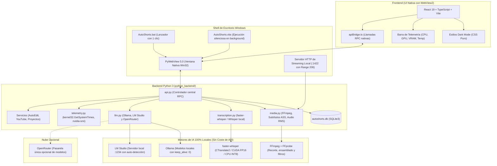

# AutoShorts

[](https://www.python.org/)
[](https://react.dev/)
[](https://www.typescriptlang.org/)
[](https://vitejs.dev/)
[](https://pywebview.flowrl.com/)
[](https://ffmpeg.org/)
[](https://github.com/SYSTRAN/faster-whisper)
[](https://opensource.org/licenses/MIT)

**AutoShorts** es una suite de escritorio de código abierto y a medida diseñada bajo una filosofía **100% Local-First**. Permite a streamers, editores y creadores de contenido procesar transmisiones en directo de 1 a 4+ horas (Twitch, Kick o YouTube) y podcasts utilizando la potencia de su propio hardware, **sin pagar suscripciones mensuales ni tarifas por minuto en APIs externas**.

Genera dos formatos de contenido listos para publicar:

1. **Clips Verticales de Alto Impacto (9:16 Shorts, TikToks, Reels):** Detección de momentos clave mediante análisis acústico y semántico, subtítulos dinámicos con animación pop estilo karaoke, insignias animadas de llamada a la acción y generación de copies virales.
2. **Autoedición y Resúmenes para YouTube (16:9 o 9:16):** Ensamblado narrativo de 1 a 30 minutos con supresión de pausas y silencios muertos, teaser gancho de apertura, marcas de tiempo para capítulos de YouTube (`Descripcion_YouTube.txt`) y miniaturas en alta definición (1080p).

> [!TIP]
> **Filosofía Local-First (Cero Coste de Operación):** La transcripción se realiza en tu propia tarjeta gráfica con `faster-whisper` (CTranslate2 / CUDA) y el razonamiento del guión se ejecuta en tu máquina mediante **Ollama** o **LM Studio**. Si deseas utilizar modelos en la nube de forma opcional, AutoShorts integra soporte para **OpenRouter**, evitando la necesidad de configurar múltiples proveedores individuales.

---

## Índice

- [Arquitectura del Sistema](#arquitectura-del-sistema)
- [Funcionalidades Principales](#funcionalidades-principales)
  - [1. Detección Inteligente de Momentos](#1-detección-inteligente-de-momentos)
  - [2. Estudio de Subtítulos Dinámicos y Presets](#2-estudio-de-subtítulos-dinámicos-y-presets)
  - [3. Autoedición de Larga Duración para YouTube](#3-autoedición-de-larga-duración-para-youtube)
  - [4. IA Local y Gestión Inteligente de VRAM](#4-ia-local-y-gestión-inteligente-de-vram)
  - [5. Módulo Quick Copy para Transcripciones y Subtítulos](#5-módulo-quick-copy-para-transcripciones-y-subtítulos)
  - [6. Importador Directo de YouTube](#6-importador-directo-de-youtube)
  - [7. Telemetría de Hardware en Tiempo Real](#7-telemetría-de-hardware-en-tiempo-real)
- [Requisitos Previos y Compatibilidad](#requisitos-previos-y-compatibilidad)
- [Instalación Paso a Paso](#instalación-paso-a-paso)
- [Modos de Ejecución](#modos-de-ejecución)
  - [Lanzador Rápido (AutoShorts.bat)](#lanzador-rápido-autoshortsbat)
  - [Lanzador Silencioso (AutoShorts.vbs)](#lanzador-silencioso-autoshortsvbs)
  - [Modo Desarrollo (Hot Reload)](#modo-desarrollo-hot-reload)
- [Configuración y Variables de Entorno](#configuración-y-variables-de-entorno)
- [Estructura del Repositorio](#estructura-del-repositorio)
- [Resolución de Problemas Frecuentes](#resolución-de-problemas-frecuentes)
- [Roadmap y Futura Release Portable](#roadmap-y-futura-release-portable)
- [Créditos y Licencia](#créditos-y-licencia)

---

## Arquitectura del Sistema



---

## Funcionalidades Principales

### 1. Detección Inteligente de Momentos

El algoritmo combina análisis acústico por energía y semántica de texto para identificar los mejores momentos sin perder contexto:

- **Segmentación adaptativa con solapamiento:** Divide transmisiones masivas en bloques de 10 minutos con 30 segundos de solapamiento mutuo para no cortar jugadas o anécdotas situadas entre bloques.
- **Análisis acústico RMS en milisegundos:** Algoritmo en Python puro (`wave`, `struct`, `math`) que procesa 1 hora de stream en menos de 1.6 segundos. Si el streamer está concentrado en un clutch o tiroteo sin hablar, el detector identifica picos sonoros (disparos, explosiones) e inyecta la etiqueta `[CLUTCH / ACCIÓN ACÚSTICA]` en la transcripción para que la IA no descarte la jugada por falta de diálogo.
- **Perfiles temáticos de contenido:**
  - *Gaming:* Bajas consecutivas, jugadas clutch, tensión y reacciones.
  - *Tutorial:* Consejos clave, explicaciones técnicas y pasos esenciales.
  - *Podcast / Charla:* Anécdotas personales, debates y momentos graciosos.
  - *General:* Detección equilibrada para cualquier tipo de transmisión.
- **Duraciones objetivo configurables:** Generación de clips con duraciones predefinidas de 30s, 1m, 2m, 3m o 5m.

---

### 2. Estudio de Subtítulos Dinámicos y Presets

El motor multimedia genera subtítulos en formato SubStation Alpha (`.ass`) con sincronización palabra por palabra, renderizados mediante el filtro `ass` de FFmpeg con soporte de aceleración por hardware:

| Preset | Tipografía | Paleta y Resalte | Descripción |
| :--- | :--- | :--- | :--- |
| **`tiktok-karaoke`** | Arial Black | Blanco con resalte amarillo neón | Estilo clásico de alta retención con animación de escala (*jump/pop*) en la palabra activa. |
| **`loud-viral`** | Impact (Ultra-bold) | Trazo 3D masivo, amarillo lima y fuego naranja | Inspirado en videos dinámicos de alto ritmo, con énfasis en palabras clave. |
| **`arcade-retro`** | Trebuchet MS | Borde rosa magenta con resalte cian activo | HUD tecnológico con estética de videojuego arcade y eSports. |
| **`cyber-terminal`** | Consolas (Monospace) | Verde fósforo con resalte cian eléctrico | Aspecto retro de terminal informática y estética hacker. |
| **`clean-editorial`** | Segoe UI | Blanco puro, borde fino y sombra suave multinivel | Adecuado para charlas, debates y entrevistas estructuradas. |
| **`modern-box`** | Arial | Texto sobre caja opaca delimitada | Máxima legibilidad en fondos con alto nivel de movimiento o colores contrastantes. |

#### Opciones de Personalización
- **Posición en pantalla:** Superior, Centro o Inferior (para evitar tapar la cámara, interfaces del juego o la botonera de TikTok/Reels).
- **Densidad de texto:** Visualización en 1 o 2 líneas.
- **Insignias CTA animadas:** Superposición de distintivos de llamada a la acción ("Suscríbete", "Sígueme para parte 2") con animaciones de rebote (*bounce-land*), deslizamiento (*slide-in*) o aparición progresiva.

---

### 3. Autoedición de Larga Duración para YouTube

AutoShorts cuenta con un espacio de trabajo diseñado para condensar directos completos en videos de formato largo para YouTube:

- **Duraciones flexibles:** Genera videos ensamblados de 1, 2, 3, 4, 5, 8, 10, 12, 15, 20, 25 o 30 minutos.
- **Relaciones de aspecto:** Formato horizontal estándar (16:9) o vertical para recopilaciones largas (9:16).
- **Supresión de silencios muertos (`detect_dead_air_silences`):** Detecta pausas prolongadas y momentos vacíos en la pista de audio para recortarlos automáticamente sin comprometer la fluidez de las frases.
- **Teaser gancho inicial (`includeTeaser`):** Sitúa los mejores segundos del momento más viral al comienzo del video para captar la atención del espectador antes del inicio cronológico.
- **Marcas de tiempo automáticas:** Guarda el archivo `Descripcion_YouTube.txt` en la carpeta del proyecto con los capítulos y marcas de tiempo (`00:00 Intro...`) listos para copiar en YouTube.
- **Miniaturas HD (1080p):** Captura el fotograma de mayor impacto y genera sugerencias de títulos llamativos.

---

### 4. IA Local y Gestión Inteligente de VRAM

AutoShorts prioriza la ejecución de modelos de lenguaje en tu propio equipo para no depender de suscripciones externas:

- **Ollama (100% Offline y Gratuito):** Compatible con `qwen2.5`, `qwen3.5`, `llama3.2`, `mistral` y `gemma2`. Cuenta con un gestor de descargas integrado dentro de la interfaz.
- **LM Studio:** Auto-detección del modelo activo conectando directamente con el endpoint local `/v1/models`.
- **Descarga inmediata de VRAM (`keep_alive: 0`):** Al finalizar la generación de momentos o copies, AutoShorts ordena al servidor local liberar de inmediato la memoria de la tarjeta gráfica. Esto permite jugar o editar video sin caídas de rendimiento por VRAM ocupada.
- **Supresión de etiquetas de razonamiento:** Oculta pensamientos intermedios (`<think>`) en modelos razonadores para entregar respuestas limpias en formato JSON sin consumo superfluo de tokens.
- **OpenRouter (Opcional):** Si prefieres consultar modelos en la nube puntualmente, puedes utilizar una única clave de OpenRouter con reintentos automáticos ante límites de tasa (HTTP 429).

---

### 5. Módulo Quick Copy para Transcripciones y Subtítulos

Permite redactar copys sociales persuasivos (gancho, cuerpo, llamado a la acción y etiquetas) a partir de tres fuentes:

- **Archivos de subtítulos (`.srt`, `.vtt`, `.txt`):** Analizador sintáctico que limpia números de secuencia, códigos de tiempo y etiquetas de formato para entregar al modelo únicamente el diálogo limpio.
- **Texto pegado:** Entrada manual con contador de palabras y caracteres en vivo.
- **Archivo multimedia directo:** Transcripción y redacción de copy en un solo proceso.
- **Rehacer copy en clips exportados:** Botón para regenerar el texto promocional de cualquier clip guardado basándose en su transcripción real sin alterar su título.

---

### 6. Importador Directo de YouTube

- Descarga automática de videos a `Downloads/AutoShorts` mediante `yt-dlp`.
- **Comprobación preventiva de derechos (`check_youtube_copyright`):** Revisa los metadatos de la URL antes de descargar y alerta si el contenido tiene licencia estándar o Creative Commons.

---

### 7. Telemetría de Hardware en Tiempo Real

Barra de estado inferior persistente con actualización periódica:
- **CPU %:** Medición no bloqueante con `GetSystemTimes` (Win32).
- **GPU y VRAM:** Lectura directa de uso y memoria asignada mediante `nvidia-smi` (con respaldo en PyTorch CUDA).
- **Temperatura de la GPU (°C):** Supervisión térmica en tiempo real durante renderizados intensivos.

---

## Requisitos Previos y Compatibilidad

| Componente | Requisito Mínimo | Recomendado | Notas |
| :--- | :--- | :--- | :--- |
| **Sistema Operativo** | Windows 10 (64-bit) | Windows 11 (64-bit) | Compatible también con Linux y macOS en modo desarrollo. |
| **Python** | 3.10 | **3.11.x** | Versión recomendada para PyTorch CUDA y PyWebView. |
| **Node.js** | 18.x (LTS) | 20.x o superior | Requerido para construir los activos de la interfaz. |
| **Gestor de Paquetes** | npm 9+ | **pnpm 9+** | Recomendado para menor tiempo de instalación. |
| **FFmpeg y FFprobe** | Versión 5.x | **Versión 6.x o 7.x en el PATH** | Indispensable para cortes, subtítulos ASS y audio RMS. |
| **GPU NVIDIA (Opcional)** | CPU Intel / AMD | **NVIDIA RTX con soporte CUDA** | Permite transcribir horas de stream en pocos minutos. |

### Instalación de FFmpeg

Asegúrate de que `ffmpeg` y `ffprobe` respondan desde la terminal:

- **Windows (PowerShell):**
  ```powershell
  winget install Gyan.FFmpeg
  ```
- **macOS:**
  ```bash
  brew install ffmpeg
  ```
- **Linux (Ubuntu / Debian):**
  ```bash
  sudo apt update && sudo apt install -y ffmpeg
  ```

---

## Instalación Paso a Paso

### 1. Clonar el Repositorio
```bash
git clone https://github.com/jeffd2599/autoshorts.git
cd autoshorts
```

### 2. Configurar el Entorno Virtual de Python
```bash
# Crear entorno virtual
python -m venv venv

# Activar en Windows (PowerShell):
.\venv\Scripts\Activate.ps1

# Activar en Linux o macOS:
source venv/bin/activate
```

### 3. Instalar PyTorch

Para aprovechar la aceleración CUDA en transcripción local:

```bash
# Con soporte NVIDIA CUDA 12.1 (Recomendado):
pip install torch torchvision torchaudio --index-url https://download.pytorch.org/whl/cu121

# O versión para CPU / sin tarjeta gráfica NVIDIA:
pip install torch torchvision torchaudio
```

### 4. Instalar Dependencias del Backend
```bash
pip install -r requirements.txt
```

### 5. Instalar y Compilar el Frontend
```bash
# Con pnpm (recomendado):
pnpm install
pnpm run build

# O con npm:
npm install
npm run build
```

---

## Modos de Ejecución

### Lanzador Rápido (AutoShorts.bat)

La forma más rápida y cómoda de ejecutar la aplicación en el día a día. Simplemente haz doble clic en el archivo:

```text
AutoShorts.bat
```

Este script por lotes:
1. Detecta automáticamente si existe un entorno virtual (`venv`, `.venv`, `env`) o utiliza el Python del sistema.
2. Inicia el servidor de streaming local y abre la ventana nativa de escritorio.
3. Si ocurre algún error inesperado, mantiene la consola abierta para que puedas leer el diagnóstico en lugar de cerrarse de golpe.

---

### Lanzador Silencioso (AutoShorts.vbs)

Si prefieres abrir la aplicación sin ninguna ventana de consola de fondo en Windows, haz doble clic en:

```text
AutoShorts.vbs
```

---

### Modo Desarrollo (Hot Reload)

Para editar la interfaz en tiempo real mientras el backend permanece activo:

1. **Terminal 1 (Vite Dev Server):**
   ```bash
   pnpm run dev
   ```
2. **Terminal 2 (Desktop Launcher):**
   ```bash
   AutoShorts.bat
   ```

El lanzador detectará el servidor en `http://127.0.0.1:1420` y conectará la ventana nativa con recarga en caliente automática.

---

## Configuración y Variables de Entorno

Puedes configurar tus opciones mediante un archivo `.env` en la raíz del proyecto o desde el panel de ajustes de la aplicación:

```env
# Proveedor principal de LLM (ollama, lmstudio u openrouter)
LLM_PROVIDER=ollama

# Servidor Local LM Studio (Opcional, por defecto http://127.0.0.1:1234/v1)
LMSTUDIO_BASE_URL=http://127.0.0.1:1234/v1

# Pasarela Cloud Opcional (Si no deseas usar inferencia local)
OPENROUTER_API_KEY=tu_clave_openrouter_aqui
```

La configuración persistente de la aplicación (modelo Whisper predeterminado, estilo de subtítulos seleccionado, rutas de proyectos) se guarda automáticamente en:
```text
%USERPROFILE%\.autoshorts\config.json
```

---

## Estructura del Repositorio

```text
autoshorts/
├── python_backend/               # Backend en Python 3
│   ├── api.py                    # Controlador RPC principal expuesto a PyWebView
│   ├── db.py                     # Capa de datos en SQLite3 embebido
│   ├── llm.py                    # Orquestador de LLMs locales (Ollama, LM Studio) y OpenRouter
│   ├── llm_prompts.py            # Plantillas de prompts especializadas por formato
│   ├── media.py                  # Integración con FFmpeg, subtítulos ASS y audio RMS
│   ├── stream_server.py          # Servidor HTTP local con soporte Range para videos
│   ├── telemetry.py              # Telemetría de CPU, GPU, VRAM y temperatura
│   ├── transcription.py          # Pipelines de faster-whisper y Whisper local
│   └── services/                 # Servicios modulares
│       ├── autoedit_service.py   # Servicio de autoedición y compilación para YouTube
│       ├── project_service.py    # Gestión de carpetas y re-vinculación de videos
│       └── youtube_service.py    # Descarga e inspección de derechos con yt-dlp
├── src/                          # Frontend en React 19 + TypeScript
│   ├── components/               # Componentes modulares de interfaz
│   │   ├── common/               # Componentes reutilizables (StatusBar, ModelBadge)
│   │   ├── modals/               # Modales de trabajo (Estudio, AutoEdit, QuickCopy)
│   │   └── panels/               # Vistas principales (Dashboard, Clips, AutoEdit)
│   ├── hooks/                    # Hooks personalizados de estado y pipelines
│   ├── styles/                   # Sistema de diseño dark mode en CSS puro
│   ├── types.ts                  # Definiciones de tipos TypeScript compartidos
│   ├── apiBridge.ts              # Adaptador RPC para comunicación con Python
│   └── App.tsx                   # Componente raíz de la aplicación
├── AutoShorts.bat                # Lanzador de un solo clic con detección de venv
├── AutoShorts.vbs                # Lanzador silencioso en segundo plano para Windows
├── run.py                        # Punto de entrada principal de la aplicación
├── requirements.txt              # Dependencias de Python
├── package.json                  # Scripts y dependencias del frontend
├── vite.config.ts                # Configuración del empaquetador Vite
└── README.md                     # Documentación técnica del proyecto
```

---

## Resolución de Problemas Frecuentes

### 1. `ffmpeg` o `ffprobe` no se reconocen como un comando
- Verifica que instalaste FFmpeg y que la ruta a su subcarpeta `bin` se encuentra en las variables de entorno del sistema (`PATH`).
- Abre una ventana nueva de PowerShell y comprueba la salida con `ffmpeg -version`.

### 2. Whisper no utiliza la tarjeta gráfica NVIDIA
- Comprueba que instalaste la versión de PyTorch con soporte CUDA.
- Puedes verificarlo ejecutando en consola:
  ```bash
  python -c "import torch; print('CUDA disponible:', torch.cuda.is_available(), '| Dispositivo:', torch.cuda.get_device_name(0) if torch.cuda.is_available() else 'Ninguno')"
  ```
- Si devuelve `False`, reinstala torch con el índice `cu121` indicado en el paso 3 de la guía de instalación.

### 3. No se detecta Ollama o LM Studio
- **Ollama:** Comprueba que el servicio está activo visitando en tu navegador `http://127.0.0.1:11434`.
- **LM Studio:** En la pestaña "Local Server", presiona el botón "Start Server" y verifica que el puerto sea el `1234`.

### 4. El archivo fuente del video se movió o renombró
- Si cambiaste de ubicación una grabación original, AutoShorts marcará el archivo con una advertencia en la lista de proyectos.
- Haz clic en el botón de re-vincular (icono de carpeta de búsqueda) para seleccionar la nueva ruta del archivo sin perder tus transcripciones ni tus momentos detectados.

---

## Roadmap y Futura Release Portable

Para simplificar al máximo la distribución a otros creadores sin requerir instalación manual de dependencias de desarrollo, se contempla en el roadmap:

- **Versión Portable para GitHub Releases:** Empaquetado integral que incluye el runtime embebido de Python, los binarios de FFmpeg y el frontend compilado en un archivo comprimido autónomo (*zero-install*).
- **Actualizador integrado:** Descarga automática de nuevas versiones y modelos ligeros directamente desde GitHub Releases.

---

## Créditos y Licencia

Este proyecto es una evolución y desarrollo derivado del trabajo conceptual de [JayWebtech/autoshorts](https://github.com/JayWebtech/autoshorts).

### Fundamentos de la Migración a Python
La versión conceptual previa utilizaba una arquitectura basada en Rust (Tauri). Para este desarrollo, el backend fue reescrito íntegramente en **Python 3.11**, aportando ventajas directas:
1. **Instalación directa sin herramientas de compilación complejas:** Elimina la necesidad de instalar el toolchain de Rust (`cargo`, `rustc`) ni Microsoft Visual C++ Build Tools.
2. **Acceso nativo a Machine Learning:** Integración inmediata con PyTorch, aceleración CUDA, faster-whisper con CTranslate2 y comunicación directa con Ollama y LM Studio.
3. **Facilidad de mantenimiento:** El procesamiento multimedia y los algoritmos acústicos RMS pueden auditarse y modificarse directamente en código Python legible.

Este software se distribuye bajo los términos de la **Licencia MIT**. Consulta el archivo [LICENSE](LICENSE) para más información.
